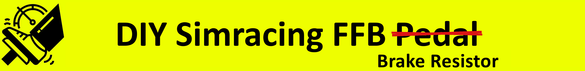
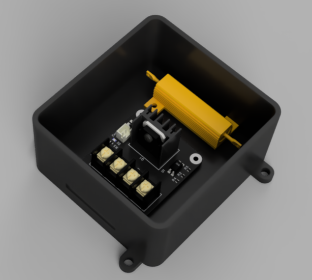
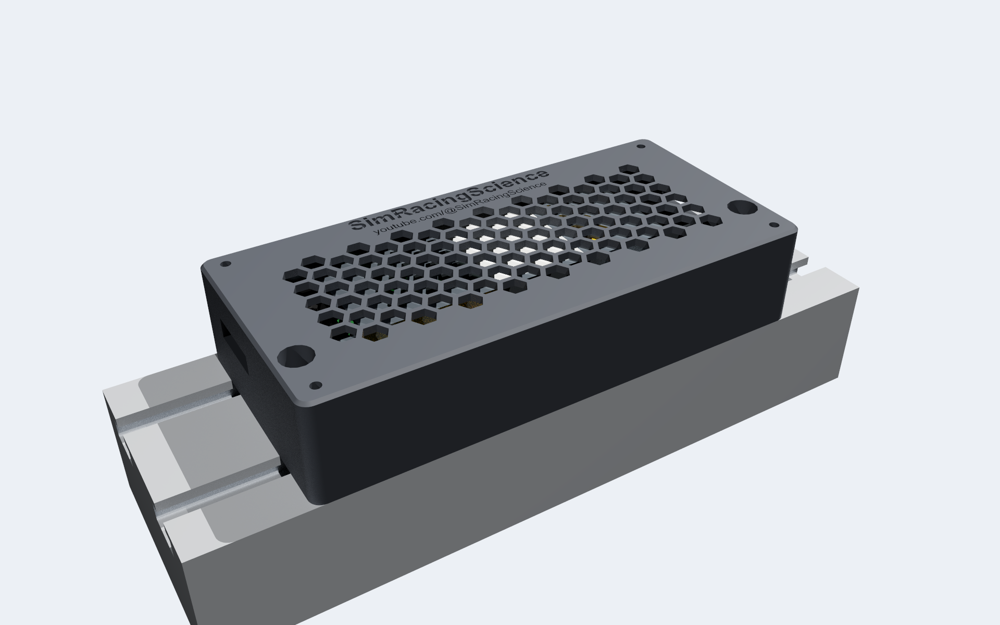

  

# DIY Sim Racing Hardware Brake Resistor

[![CC BY-NC-SA 4.0][cc-by-nc-sa-shield]][cc-by-nc-sa]

A **standalone hardware brake resistor** for the [DIY Sim Racing FFB Pedal project](https://github.com/ChrGri/DIY-Sim-Racing-FFB-Pedal).

When the pedal servos decelerate quickly, they act as generators and feed energy back into the 36 V supply rail. A brake resistor turns this energy into heat, so the servos don't trip their overvoltage protection and the pedal can run at full speed. Both variants work purely in hardware, with **no connection to the ESP32**.

---

## 🔀 Two Variants

| | **Variant 1: DIY MOSFET board** | **Variant 2: MKS brake resistor module** |
| :--- | :---: | :---: |
| |  |  |
| **Concept** | 3D-printer heated-bed MOSFET board, switched by a 39 V zener diode, with an 8 Ω / 50 W resistor | Ready-made Makerbase MKS Brake Resistor Module V1.0, plus a second 8 Ω / 50 W resistor in parallel (recommended) |
| **Reverse-current protection** | External SR5100 Schottky diode in the PSU lead (soldered by you) | Schottky diode already integrated in the module |
| **Effort** | More DIY work: solder the Schottky diode, crimp the resistor, zener diode and wire | Plug and play: screw terminals only (WAGO connector optional) |
| **Cost** | approx. 10–15 € (tools not included) | approx. 20–25 € |
| **Tools** | Soldering iron, crimping tool (optional), wire stripper, screwdriver | Screwdriver |
| **Build guide** | [BuildGuide_DIY_MOSFET.md](docs/BuildGuide_DIY_MOSFET.md) | [BuildGuide_MKS_Module.md](docs/BuildGuide_MKS_Module.md) |
| **Printable housing** | [HardwareBrakeResistorHousing_V1.3mf](3d_print/HardwareBrakeResistorHousing_V1.3mf) | [Tray](3d_print/MKS_BrakeResistor_8040_Tray.3mf) + [Lid](3d_print/MKS_BrakeResistor_8040_Lid.3mf) (for 8040 profile) |

> [!TIP]
> **Both concepts work equally well.** The MKS module is the more off-the-shelf solution: no soldering, no crimping, just screw terminals. **Author's recommendation: Variant 2 (MKS module).** Choose Variant 1 if you enjoy building it yourself or want the cheapest option.

Measurements and resistor sizing: [docs/BrakeResistorAnalysis.md](docs/BrakeResistorAnalysis.md)

> [!WARNING]
> Brake resistors handle high currents and get hot. Read the safety notes in the build guide before switching on.

---

## 🛠️ Firmware Setting

For both variants, set **Regen energy** to **"Hardware brake resistor circuit only"** in the pedal settings of the SimHub plugin.

---

## 💖 Supporting the Project

If this project helps bring your sim racing rig to life, consider supporting further open-source development:

### 🛒 Affiliate Disclosure

The shop links in the build guides are affiliate links. As an Amazon Associate I earn from qualifying purchases. The price stays the same for you, and you support the further development of the project. Thank you!

---

## 📄 License

This work is licensed under a [Creative Commons Attribution-NonCommercial-ShareAlike 4.0 International License (CC BY-NC-SA 4.0)][cc-by-nc-sa].

[![CC BY-NC-SA 4.0][cc-by-nc-sa-image]][cc-by-nc-sa]

[cc-by-nc-sa]: http://creativecommons.org/licenses/by-nc-sa/4.0/
[cc-by-nc-sa-image]: https://licensebuttons.net/l/by-nc-sa/4.0/88x31.png
[cc-by-nc-sa-shield]: https://img.shields.io/badge/License-CC%20BY--NC--SA%204.0-lightgrey.svg
