<p align="center">
  
</p>

# DIY Sim Racing Hardware Brake Resistor ("Poor Man's Brake Resistor")

[![CC BY-NC-SA 4.0][cc-by-nc-sa-shield]][cc-by-nc-sa]
[](https://www.simhubdash.com/)
[](https://ko-fi.com/captainchris88)
[](https://buymeacoffee.com/captainchris)

This repository describes a **standalone hardware brake resistor** for the [DIY Sim Racing FFB Pedal project](https://github.com/ChrGri/DIY-Sim-Racing-FFB-Pedal).

It is built from a **cheap 3D-printer heated-bed MOSFET board**, a 50 W power resistor and a few small parts. **Parts cost: roughly 10 €.**

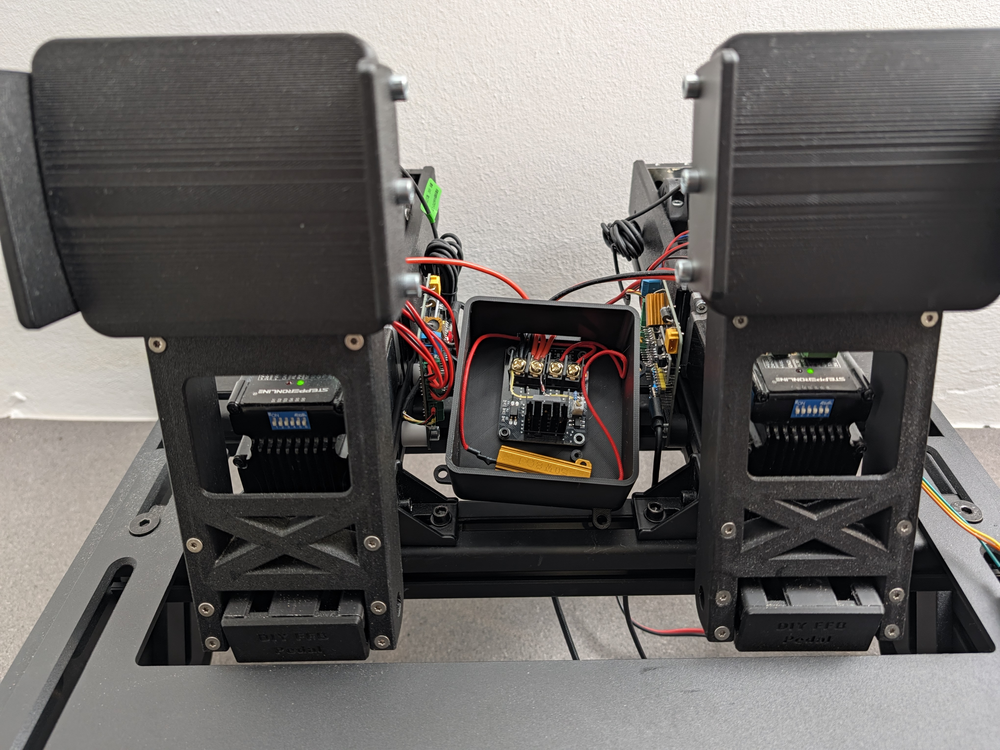

> [!NOTE]
> The module was placed between the pedals for testing only. It can be mounted much more neatly underneath the rig.

---

## 🚀 Key Highlights

* **Around 10 € in parts:** A standard 3D-printer heated-bed MOSFET board, an 8 Ω / 50 W resistor, a 39 V zener diode, a 10 kΩ resistor and an SR5100 Schottky diode.
* **Fully autonomous:** The voltage clamp works purely in hardware. **No connection to the ESP32** is needed.
* **Full pedal speed:** The pedal holds its maximum velocity all the way to the endstop. The bus voltage never exceeds 44 V (see [Measurements](#-measurements)).
* **Simpler wiring:** The servo supply no longer goes through the pedal PCB. The power supply connects directly to the module, and the module connects directly to the servos.
* **Crimp or solder:** Plug the parts onto the board with a JST connector, or solder them to the underside of the board to save a few euros.
* **3D-printable housing:** Optional enclosure for the board and the resistor included.

---

## ⚙️ How It Works

When the pedal servos decelerate quickly, they act as generators and feed energy back into the supply rail. This makes the voltage on the 36 V rail rise. If it rises too far, the servos trip their overvoltage protection or the power supply shuts down.

This circuit clamps the voltage purely in hardware:

1. The **SR5100 Schottky diode** sits between the power supply and the module. Regenerated energy cannot flow back into the power supply and stays on the servo side.
2. The **39 V zener diode** starts conducting as soon as the servo voltage exceeds about 39 V plus the optocoupler threshold (≈ 40–41 V).
3. The current through the zener diode drives the optocoupler input of the MOSFET board. The MOSFET turns on and connects the **8 Ω / 50 W resistor** across the supply.
4. The excess energy is turned into heat in the resistor, the voltage drops, and the MOSFET turns off again.
5. The **10 kΩ resistor** sits in parallel with the board input. It drains the small leakage current of the zener diode below the threshold, so the MOSFET doesn't partially turn on too early.

### 🔌 Power Wiring: the Pedal PCB Is No Longer in the Servo Supply Path

With the brake resistor module, the power supply on the pedal PCB is **no longer needed**. Instead, the wiring goes:

**PSU → (SR5100) → brake resistor module (DC IN + / −) → directly to the servos**

The **DC IN** terminals of the MOSFET board serve as the distribution point: the supply lead from the power supply and the supply wires of all servos go into the same **DC IN +** and **DC IN −** terminals (see the photo in [step 9](#9️⃣-housing-optional)).

---

## 📊 Measurements

### Single Hard Brake Stroke

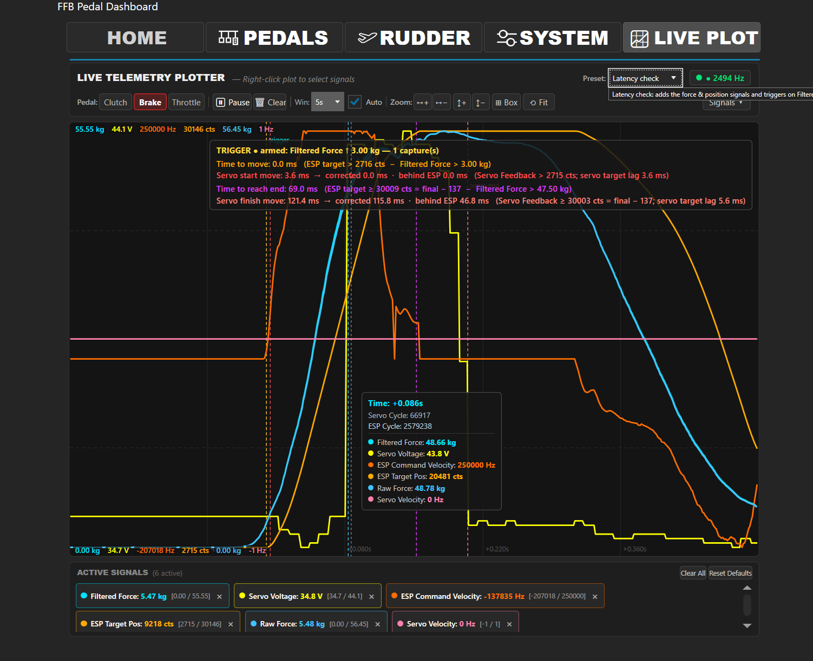

*Live plot from the FFB Pedal Dashboard: one hard brake stroke with the hardware brake resistor installed.*

* **ESP Command Velocity** (orange) stays at the maximum of **250 000 Hz** until the pedal reaches the endstop. The pedal does not have to slow down to protect the supply rail.
* **Servo Voltage** (yellow) rises from 34.7 V at rest and **never exceeds 44 V** (peak 44.1 V).
* The force reaches about 55 kg, and the pedal travels to the endstop in about 69 ms.

### Repeated Fast Pedal Movements

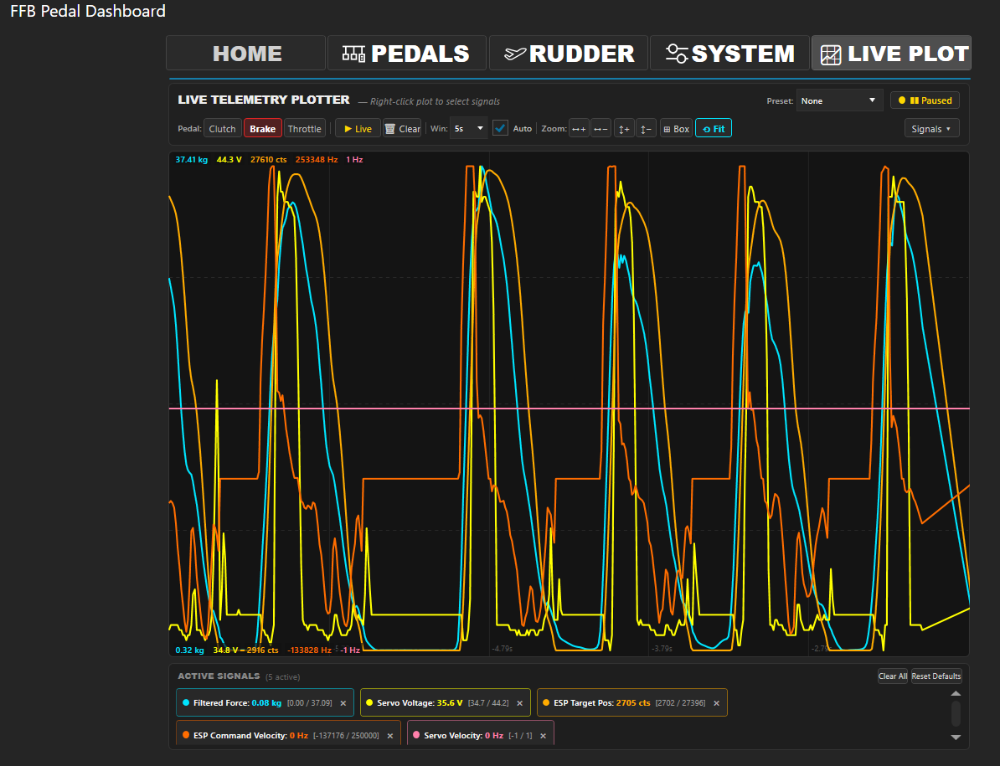

*Servo voltage (yellow) during repeated fast, hard pedal movements. The voltage stays between approx. 34.8 V and 44.3 V.*

---

## 📦 Bill of Materials (BOM)

| Qty | Part | Amazon | AliExpress |
| :--- | :--- | :--- | :--- |
| 1 | MOSFET board (3D printer heated bed) | [Link](https://link.amazon/B00ke56jL) | [Link](https://s.click.aliexpress.com/e/_c3aylBSN) |
| 1 | Resistor 50 W / 8 Ω (aluminium housing) | [Link](https://link.amazon/B0ddH9qBs) | [Link](https://s.click.aliexpress.com/e/_c3Blbzrf) |
| 1 | Resistor 10 kΩ | [Link](https://link.amazon/B01VS7jOm) | [Link](https://s.click.aliexpress.com/e/_c37xX64H) |
| 1 | Zener diode 39 V | [Link](https://link.amazon/B076pziGp) | [Link](https://s.click.aliexpress.com/e/_c3vdG0Rx) |
| 1 | Schottky diode SR5100 (5 A / 100 V) | – | – |
| 1 | Short wire (jumper to DC IN −) | – | – |
| – | Wire for the 8 Ω resistor (e.g. 16 AWG silicone), heat shrink tubing | – | – |
| optional | JST 2.54 mm connector, 2-pin | [Link](https://link.amazon/B0fwLvwqI) | [Link](https://s.click.aliexpress.com/e/_c3m81rrX) |
| optional | Crimping tool | [Link](https://link.amazon/B06MTvK9t) | – |

* **🔧 Tools:** soldering iron, side cutters, wire stripper, screwdriver, heat gun or lighter for the heat shrink.
* **🖨️ Housing (optional):** [3d_print/HardwareBrakeResistorHousing_V1.3mf](3d_print/HardwareBrakeResistorHousing_V1.3mf)

> [!TIP]
> **Connector or solder?**
> - **With JST connector (plugged in on top of the board):** If you already have a crimping tool and JST 2.54 mm connectors, crimp the zener diode, the 10 kΩ resistor and the short wire into a 2-pin JST connector and plug it into the input header on top of the MOSFET board. Clean and removable at any time. This is how it is built in the photos below.
> - **Without connector (soldered underneath):** The cheaper option. Solder the parts directly to the two pins of the input header from the underside of the board. Electrically identical.

---

## 📐 Schematic

```
                  SR5100
 PSU +V ───────────►|────────► DC IN + (MOSFET board) ─────────► Servos +V
                (band to          │
                 module)          └──|◄── Zener 39 V ──┬──► JST input +
                                  (band to DC IN +)    │
                                                     10 kΩ
                                                       │
 PSU −V ─────────────────────► DC IN − ── short wire ──┴──► JST input −
                                  │
                                  └────────────────────────────► Servos −V

 HOT BED + / − ── 8 Ω / 50 W resistor
```

| Part | Connection |
| :--- | :--- |
| **Zener diode** | Cathode (band) to **DC IN +**, anode to the **+ pin** of the board input. |
| **10 kΩ** | Across the two pins of the board input. |
| **Short wire** | From the **− pin** of the board input to **DC IN −**. |
| **SR5100** | Anode to the power supply **+V**, cathode (band) towards the MOSFET board. |
| **Servos** | Supply wires directly into **DC IN +** and **DC IN −** of the MOSFET board. |
| **8 Ω / 50 W** | To the two **HOT BED** terminals. Polarity doesn't matter. |

> [!NOTE]
> The polarity of the board input is marked on the PCB. If it is reversed, nothing happens (the optocoupler simply stays off). In that case, connect the plug the other way around.

---

## 🛠️ Build Guide

### 1️⃣ Lay Out the Parts

MOSFET board, JST housing with two crimp contacts, 39 V zener diode (red, glass), 10 kΩ resistor (blue), short wire (yellow) and the SR5100 diode.

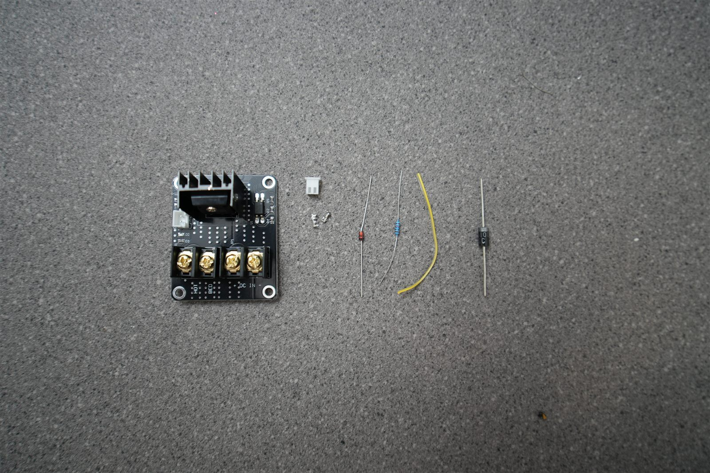

### 2️⃣ Prepare the Zener Diode, 10 kΩ Resistor and Wire

Crimp the anode of the zener diode (the side **without** the band) and the short wire into one crimp contact each. Place the 10 kΩ resistor between the two contacts so that it bridges both pins.

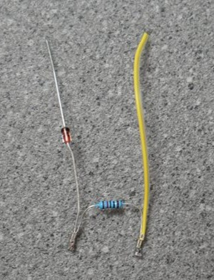

**Without a crimping tool (optional):** skip steps 2 and 3 and solder the parts directly to the input pins on the underside of the board. Put some insulating tape on the board underneath the parts so the leads can't touch the other solder joints:

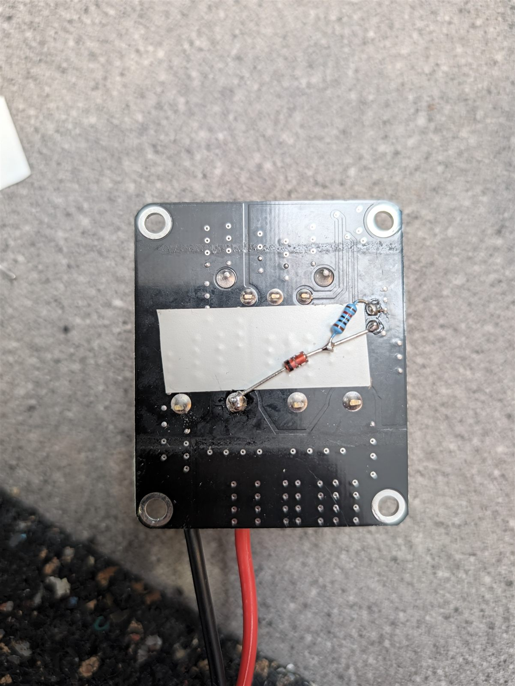

### 3️⃣ Insert into the JST Housing

Snap both contacts into the 2-pin JST housing. The zener diode must end up on the **+ pin** of the board input.

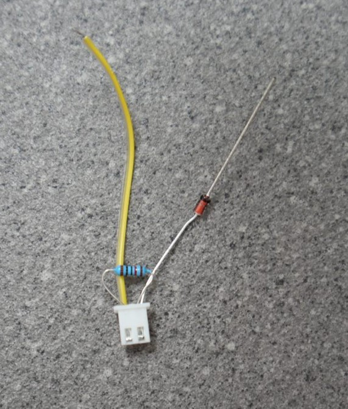

### 4️⃣ Plug onto the MOSFET Board and Connect

* Plug the JST connector into the input header of the board (or solder it on from below).
* Put the free end of the zener diode (band side / cathode) into the **DC IN +** terminal.
* Put the short wire into the **DC IN −** terminal.

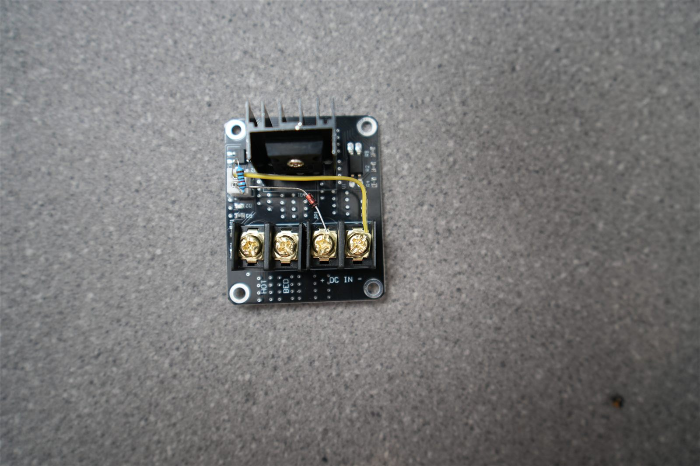

### 5️⃣ Connect the Brake Resistor

Connect the 8 Ω / 50 W resistor with two wires to the two **HOT BED** terminals. Insulate the solder joints on the resistor with heat shrink.

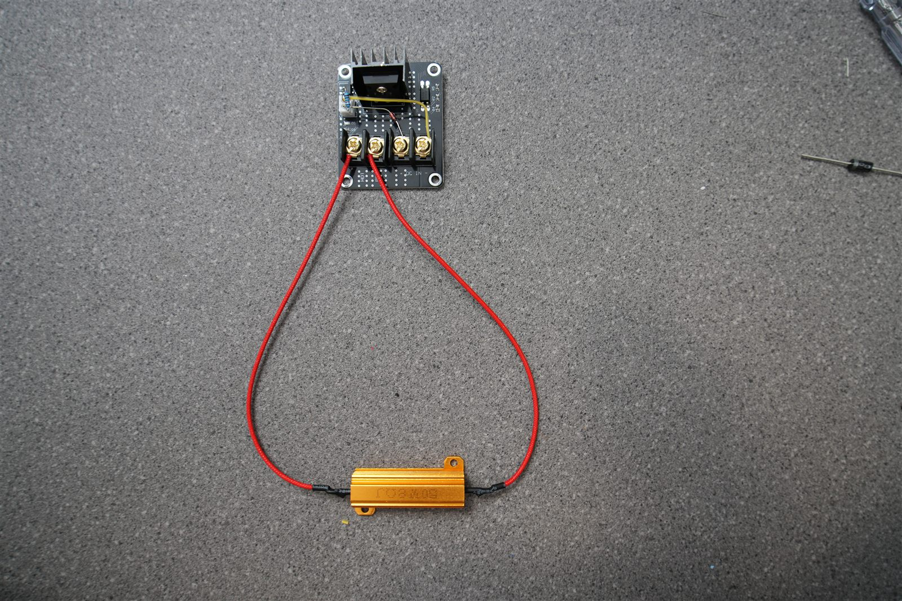

### 6️⃣ Put the SR5100 into the Power Supply Lead

Solder the SR5100 into the **+ lead** between the power supply and the module. The cathode (band) points to the wire going to the module, the anode goes to the power supply.

Slide the heat shrink over the wire **before** soldering.

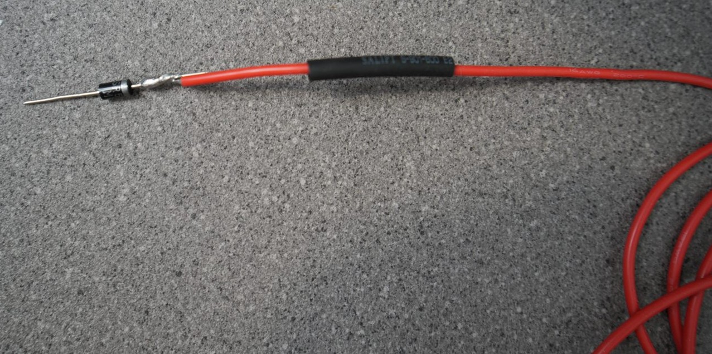

Insulate the solder joint with heat shrink so that only the anode leg sticks out:

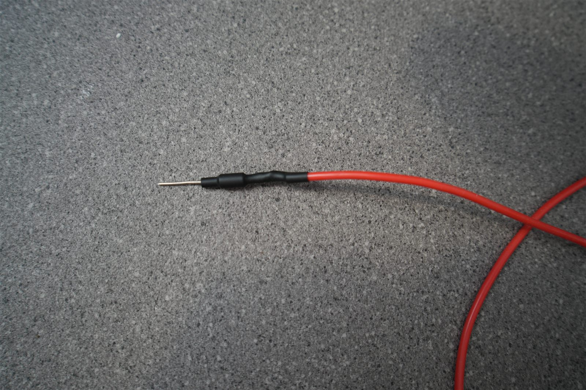

### 7️⃣ Connect to the Power Supply

Screw the anode leg of the SR5100 into the **+V** terminal of the power supply and connect ground to **−V**. The other ends of both wires go to **DC IN +** and **DC IN −** of the MOSFET board.

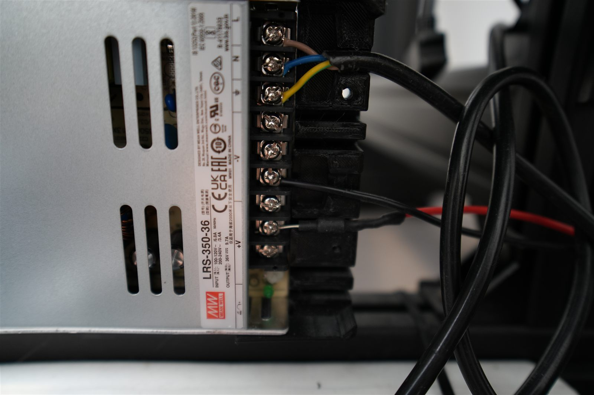

### 8️⃣ Firmware Setting

In the SimHub plugin, set **Regen energy** to **"Hardware brake resistor circuit only"** in the pedal settings.

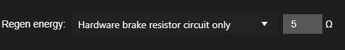

In this mode the firmware:

* keeps its own brake resistor output off,
* turns off the servo's internal bleeder, so the hardware circuit takes the regenerated energy,
* no longer limits the pedal speed to keep the regenerated power low.

### 9️⃣ Housing (Optional)

Mount the board and the resistor in the 3D-printed housing: [3d_print/HardwareBrakeResistorHousing_V1.3mf](3d_print/HardwareBrakeResistorHousing_V1.3mf). The aluminium resistor gets hot. Leave some air in the housing and don't screw it directly onto thin PLA.

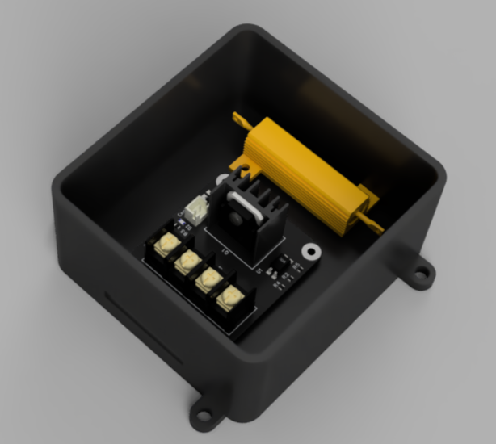

Then wire the servos directly to the module: their supply wires go into **DC IN +** (red) and **DC IN −** (black), together with the supply lead from the power supply. The servo supply no longer passes through the pedal PCB.

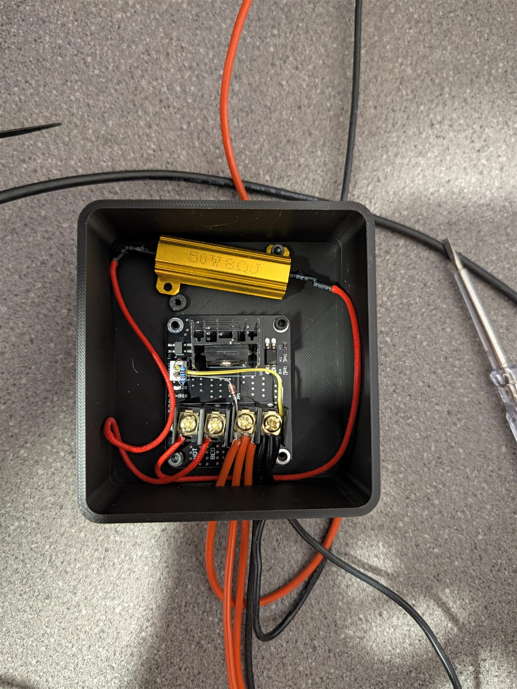

---

## ⚠️ Disclaimer & Safety

> [!WARNING]
> **The brake resistor handles high currents and gets hot.**
> - **The power supply voltage must stay below the switching threshold.** The circuit is designed for a 36 V power supply (e.g. Mean Well LRS-350-36). Many power supplies have a potentiometer for adjusting the voltage. **Do not turn it above approx. 37 V.** If the supply voltage is above the zener threshold, the resistor stays on permanently: 36 V across 8 Ω is 4.5 A or ~160 W, far more than the resistor's 50 W.
> - **SR5100 current rating:** The SR5100 is rated for 5 A, and the full servo current flows through it. For very high continuous currents, use a stronger Schottky diode (e.g. 10 A).
> - **The resistor gets hot.** After normal driving it should only be warm. If it gets very hot, check the power supply voltage and the wiring.
> - **Check the polarity** (zener diode, SR5100) before switching on the power supply.
> - Only work on the power supply when it is **unplugged**. Do not touch the mains side.
> - Use this project responsibly and at your own risk.

---

## 💖 Supporting the Project

If this project helps bring your sim racing rig to life, consider supporting further open-source development:

[](https://ko-fi.com/captainchris88)
[](https://buymeacoffee.com/captainchris)

### 🛒 Affiliate Disclosure

The links in the bill of materials are affiliate links. As an Amazon Associate I earn from qualifying purchases. The price stays the same for you, and you support the further development of the project. Thank you!

---

## 📄 License

This work is licensed under a [Creative Commons Attribution-NonCommercial-ShareAlike 4.0 International License (CC BY-NC-SA 4.0)][cc-by-nc-sa].

[![CC BY-NC-SA 4.0][cc-by-nc-sa-image]][cc-by-nc-sa]

[cc-by-nc-sa]: http://creativecommons.org/licenses/by-nc-sa/4.0/
[cc-by-nc-sa-image]: https://licensebuttons.net/l/by-nc-sa/4.0/88x31.png
[cc-by-nc-sa-shield]: https://img.shields.io/badge/License-CC%20BY--NC--SA%204.0-lightgrey.svg
