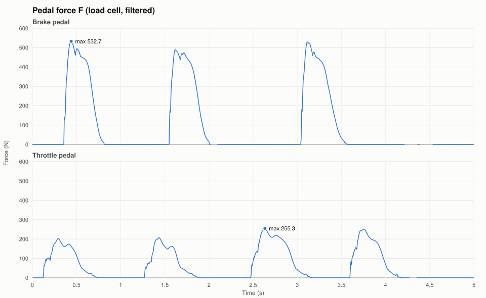
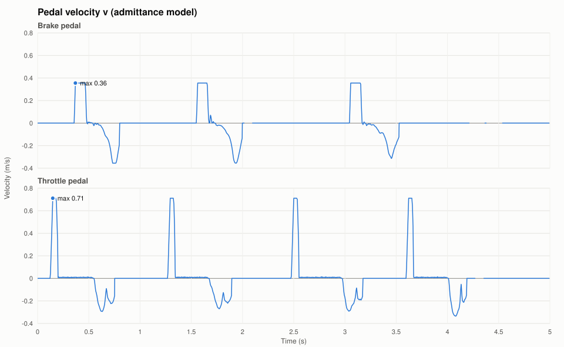
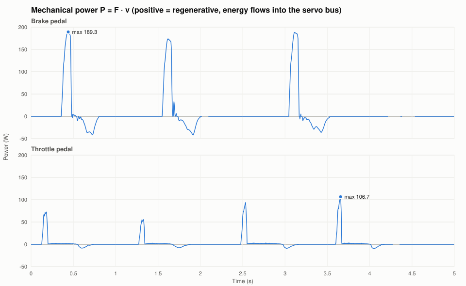
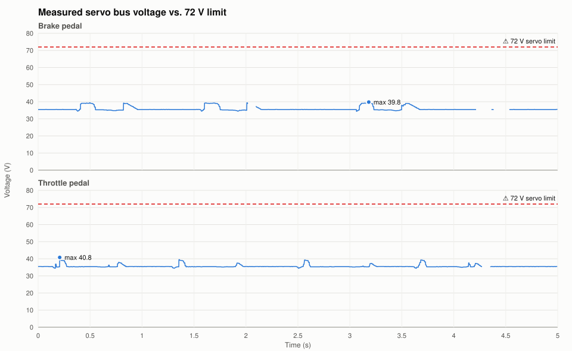

# Brake resistor sizing from pedal logs

This note uses two 5 s pedal logs to work out how much power the servo feeds back into the bus. From that it sizes the external resistor that goes in parallel with the 30 Ω resistor inside the MKS brake resistor module.

Logs used ([`docs/logs`](logs)):

| Pedal | Spindle pitch | Log file |
|---|---:|---|
| Brake | 5 mm/rev | `DiyFfbPedalStateLog_Brake_LivePlot20261104_202207.txt` |
| Throttle | 10 mm/rev | `DiyFfbPedalStateLog_Throttle_LivePlot20261104_200021.txt` |

The throttle pedal uses a spindle with twice the pitch of the brake pedal (values from `spindlePitch_mmPerRev_u8` in the pedal configs). At the same motor speed, its pedal therefore moves about twice as fast. This explains its higher velocity cap (about 0.71 m/s vs 0.36 m/s, see below), while the brake pedal reaches higher forces.

The plots and numbers come from [`tools/LogAnalysis.cs`](tools/LogAnalysis.cs). To reproduce them, run `dotnet run -- ../logs ../figures` inside `docs/tools`.

## Signals and method

| Quantity | Log column | Conversion |
|---|---|---|
| Force F | `pedalForceFiltered_fl32` (kg) | × 9.81 → N |
| Velocity v | `admittance_virtualVelocity_mps` | m/s |
| Bus voltage | `servoVoltage_fl32` | V |

Two checks confirm that force and velocity are given in the same reference frame:

- At its peak, `pedalForceFiltered × 9.81` matches `admittance_expectedForce_N`.
- `admittance_virtualVelocity_mps` is the time derivative of `admittance_virtualPosition_m` (slope 1.00, R² ≥ 0.99).

The mechanical power is

$$P(t) = F(t)\cdot v(t)$$

- **P > 0:** the foot moves the pedal in the direction it pushes. The servo is back-driven and works as a generator, so energy flows into the DC bus. This is the case the brake resistor must handle.
- **P < 0:** the servo drives the pedal against the foot (motoring).

The sign convention is confirmed by the data: every positive power burst is followed within a few tens of milliseconds by a rise in bus voltage.

**Data gaps.** The brake log has five gaps between 12 and 146 ms (0.37 s in total). All of them fall in quiet phases (t = 2.02 s and t = 4.2–4.5 s). The throttle log has one gap of 79 ms. The plots leave these gaps empty, and the energy integrals skip them instead of interpolating across them.

## Force and velocity

The velocity stays flat at about 0.36 m/s (brake) and 0.71 m/s (throttle) while the pedal is pressed quickly. The regenerated power therefore grows mainly with the force applied during the stroke.

**Where the velocity cap comes from.** `currentSpeedInHz` is limited to 250 000 steps/s in both logs. The ratio between step position and position in the log gives about 700 steps/mm on the brake (5 mm pitch) and 352 steps/mm on the throttle (10 mm pitch), i.e. about 3500 steps per revolution in both cases.

| | Brake (5 mm/rev) | Throttle (10 mm/rev) |
|---|---:|---:|
| Velocity at 4000 rpm | 0.333 m/s | 0.667 m/s |
| Velocity at 250 kHz step rate (≈ 4290 rpm at 3500 steps/rev) | 0.357 m/s | 0.714 m/s |
| Measured cap | 0.355 m/s | 0.711 m/s |

The measured caps match the 250 kHz step-rate limit of the firmware. They are about 7 % above what a 4000 rpm motor limit would give. Two caveats apply:

- The velocity is the admittance-model velocity (`admittance_virtualVelocity_mps`), not a direct measurement of the sled.
- The 3500 steps/rev are derived from the log, not read from the servo configuration. If the servo is set to 3200 steps/rev, 250 kHz would correspond to about 4690 rpm, and the model velocity would be scaled slightly differently from the real sled velocity.

## Power

| Pedal | F max (N) | v max (m/s) | P regen peak (W) | P regen peak, 10 ms mean (W) | P motoring peak (W) | Regenerated energy (J) | Mean regen power (W) |
|---|---:|---:|---:|---:|---:|---:|---:|
| Brake | 532.7 | 0.36 | **189.3** | 189.0 | −41.9 | 49.9 | 10.8 |
| Throttle | 255.3 | 0.71 | **106.7** | 103.6 | −9.6 | 17.5 | 3.6 |

- **Brake pedal:** All three hard brake applications produce bursts of 170–190 W that last about 100 ms each. The 10 ms mean is almost the same as the instantaneous peak, so these are sustained bursts and not single-sample spikes.
- **Mean power:** Even under repeated hard braking the average stays around 11 W. That is easy for an aluminium-housed 50 W resistor. The short peaks decide the resistance value.
- **Conservative estimate:** These are mechanical figures. Losses in the servo and drive reduce the electrical power that reaches the bus, so sizing for the mechanical peak leaves extra margin.

## Required brake resistance

A shunt brake resistor is switched across the bus when the voltage rises above the turn-on threshold $V_\text{on}$. At that voltage it absorbs

$$P_R = \frac{V_\text{on}^2}{R}$$

To absorb the peak regenerated power, the total resistance must therefore be at most

$$R_\text{total} \le \frac{V_\text{on}^2}{P_\text{regen,peak}}$$

The module's internal resistor $R_\text{int} = 30\ \Omega$ and the external resistor $R_\text{ext}$ are in parallel:

$$\frac{1}{R_\text{total}} = \frac{1}{R_\text{int}} + \frac{1}{R_\text{ext}}
\quad\Rightarrow\quad
R_\text{ext} \le \frac{R_\text{int}\, R_\text{total}}{R_\text{int} - R_\text{total}}$$

**Choice of V_on.** The bus sits at about 35.4 V. During every brake burst it flattens at about 39 V and peaks at 39.8 V (40.8 V on the throttle). This suggests that the chopper starts conducting in that range, but the logs do not confirm it. The table below uses $P_\text{regen,peak} = 190\ \text{W}$ and lists V_on = 40 V as the design point. 45 V and 48 V are included for comparison.

| V_on | R_total max | R_ext max (∥ 30 Ω) | Power of 30 Ω alone |
|---:|---:|---:|---:|
| 40 V | 8.4 Ω | **11.7 Ω** | 53 W |
| 45 V | 10.7 Ω | 16.5 Ω | 68 W |
| 48 V | 12.1 Ω | 20.4 Ω | 77 W |

The 30 Ω resistor alone covers only about a third of the measured 190 W peak, which is why an external resistor is needed.

**Selected part:** an **8 Ω HS50** (50 W, aluminium housing) in parallel. This gives

- R_total = 30 ∥ 8 = **6.3 Ω**
- P at 40 V = 40² / 6.3 = **253 W**, about 33 % more than the 190 W peak
- I at 40 V = 40 / 6.3 = 6.3 A, well below the module's 20 A rating

A 10 Ω part (R_total = 7.5 Ω, 213 W at 40 V) would be the upper limit with only about 12 % margin. 12 Ω or more is too high for V_on = 40 V. Bursts of about 100 ms are well within the short-term overload capability of HS-series resistors, and the average load of about 11 W is far below the 50 W rating.

The pedal configuration stores `brakeResistorResistance_Ohm_u8 = 33`. If the firmware uses this value, update it to the new total resistance.

## Servo bus voltage

| Pedal | V min | V median | V max | Margin to 72 V |
|---|---:|---:|---:|---:|
| Brake | 34.4 V | 35.4 V | 39.8 V | 32.2 V |
| Throttle | 34.5 V | 35.4 V | 40.8 V | 31.2 V |

In both logs the bus voltage stays far below the 72 V limit of the servo. The regen events raise it by at most 5.4 V above the nominal 35.4 V.
