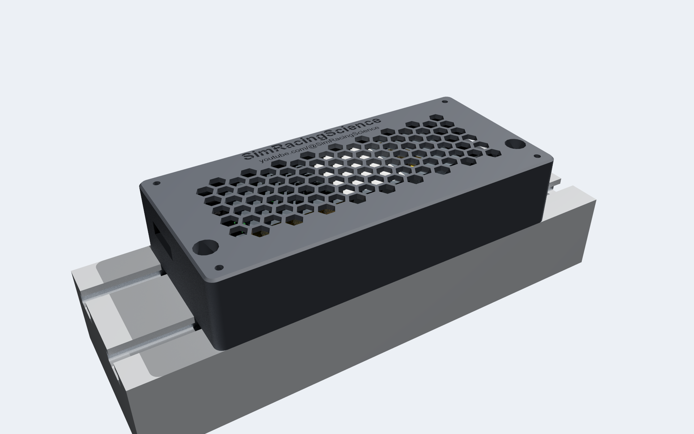
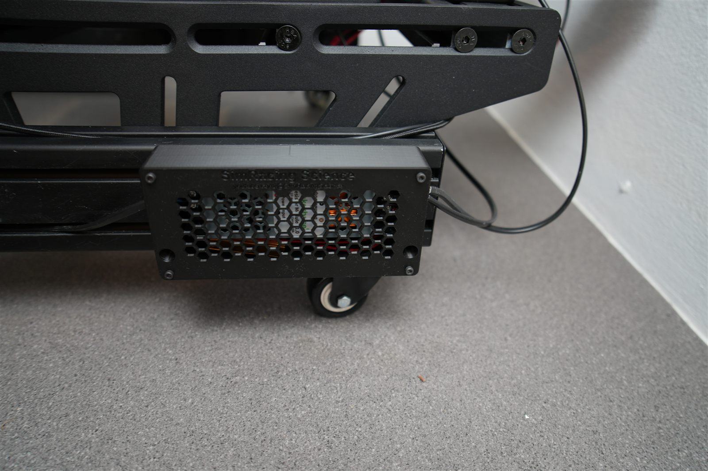
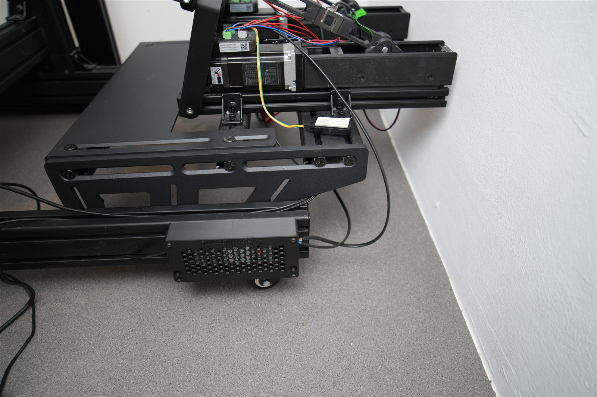
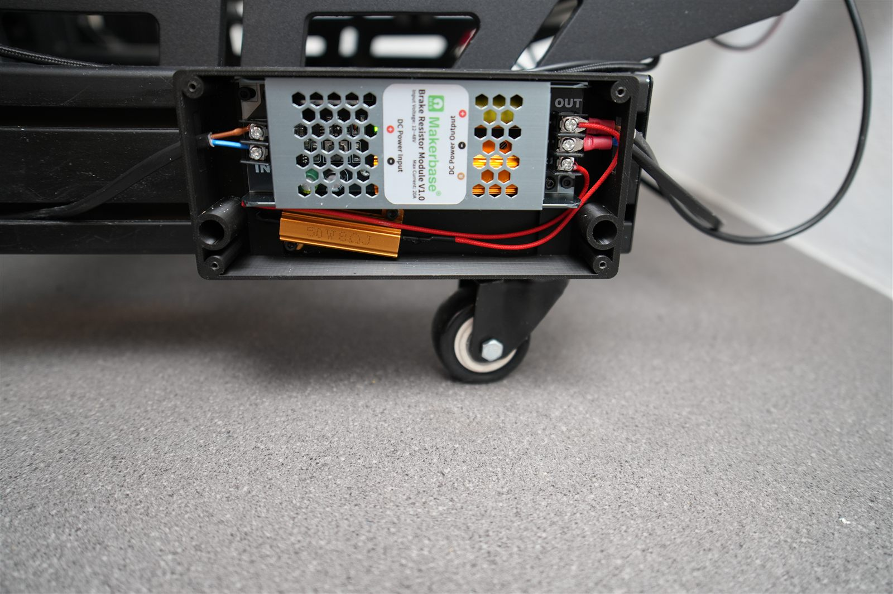
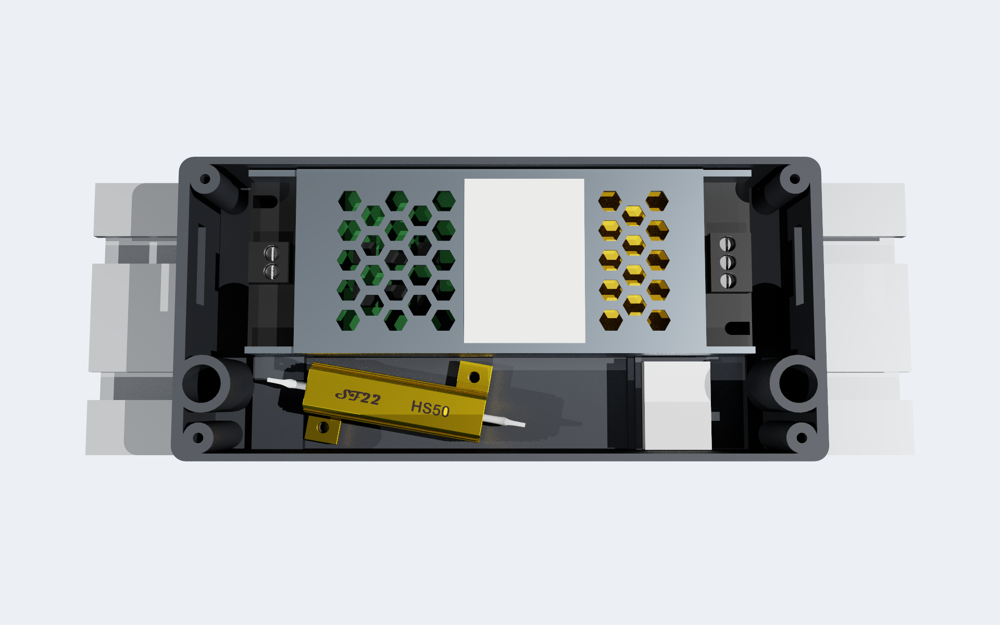
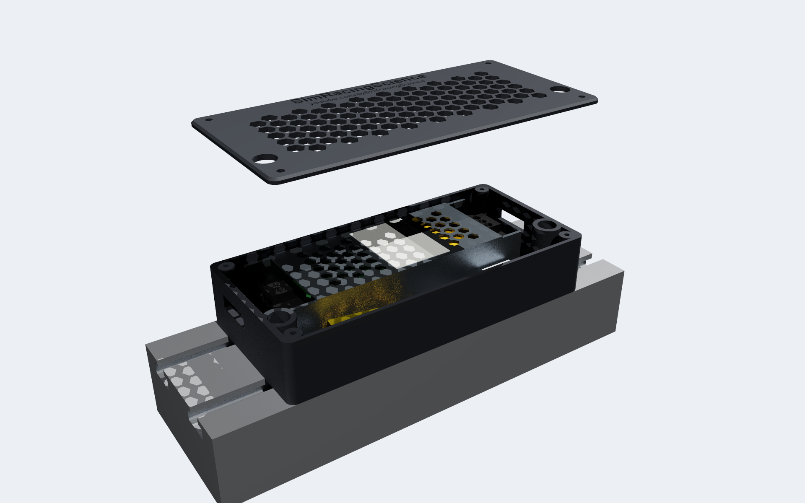
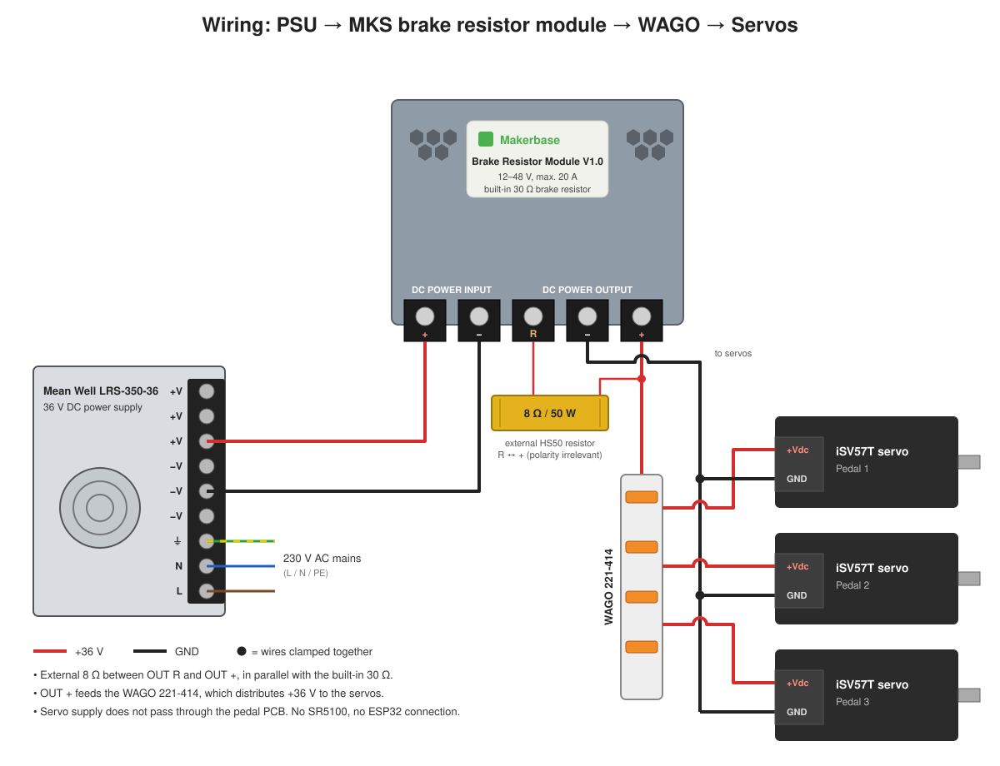

# Variant 2: MKS Brake Resistor Module

[← Back to overview](../README.md)

This variant uses the ready-made **Makerbase MKS Brake Resistor Module V1.0** (12–48 V, 20 A). It has a built-in 30 Ω brake resistor and an integrated Schottky diode that keeps regenerated energy out of the power supply, so no external SR5100 is needed. Nothing has to be soldered or crimped: every connection is a screw terminal (optionally a WAGO lever connector).

An external **8 Ω / 50 W resistor** is recommended in parallel with the built-in one. The [log analysis](BrakeResistorAnalysis.md) shows brake strokes that feed up to about 190 W back into the bus, and the 30 Ω resistor alone can take only about 53 W. With 30 Ω ∥ 8 Ω = 6.3 Ω, the combination can take about 250 W.

**Parts cost: roughly 20–25 €.** The only tool you need is a screwdriver.

---

## 📷 Installed on the Rig

The enclosure sits on the side of the 8040 base profile, below the pedal plate. The cables leave through the slots in the end walls.

With the lid removed: the MKS module, with the 8 Ω / 50 W resistor below it, wired to the **OUT** terminals.

> [!NOTE]
> The photos show the first printed prototype. The current CAD revision adds a pocket for the WAGO connector and standoffs that hold the resistor at an angle. Use the files linked below.

---

## 📦 Bill of Materials (BOM)

| Qty | Part | Note | AliExpress |
| :--- | :--- | :--- | :--- |
| 1 | MKS Brake Resistor Module V1.0 | Makerbase, 12–48 V, 20 A | [Link](https://s.click.aliexpress.com/e/_c31FusP9) |
| 1 | Resistor 50 W / 8 Ω, aluminium housing (HS50) | Connected in parallel with the module's built-in 30 Ω | [Link](https://s.click.aliexpress.com/e/_c3Blbzrf) |
| optional | WAGO 221-414 | 4-conductor lever connector that joins the + leads. Not needed if the leads go directly into the OUT + terminal | [Link](https://s.click.aliexpress.com/e/_c3u9xxOr) |
| 2 | M5 × 12 cap screw | Fastens the enclosure to the 8040 profile | [Link](https://s.click.aliexpress.com/e/_c4nAhFQr) |
| 2 | M5 T-nut | For the T-slot of the 8040 profile | [Link](https://s.click.aliexpress.com/e/_c443tord) |
| 2 | M3 × 8 screw | Fastens the module to the tray | [Link](https://s.click.aliexpress.com/e/_c3xn0ow3) (M3 screw assortment) |
| 2 | M3 × 6 screw | Fastens the 8 Ω resistor to the tray | [Link](https://s.click.aliexpress.com/e/_c3xn0ow3) (M3 screw assortment) |
| 4 | M3 × 8 screw | Fastens the lid | [Link](https://s.click.aliexpress.com/e/_c3xn0ow3) (M3 screw assortment) |

The M3 holes in the tray are 2.7 mm core holes, so the screws cut their own thread in the plastic. No threaded inserts are needed.

The shop links are affiliate links (see [Affiliate Disclosure](../README.md#-affiliate-disclosure)).

## 🖨️ Printable Enclosure

| Part | File |
| :--- | :--- |
| Tray | [3d_print/MKS_BrakeResistor_8040_Tray.3mf](../3d_print/MKS_BrakeResistor_8040_Tray.3mf) |
| Lid | [3d_print/MKS_BrakeResistor_8040_Lid.3mf](../3d_print/MKS_BrakeResistor_8040_Lid.3mf) |

* **Mounting:** The enclosure is 170 × 80 × 34.5 mm. It sits lengthwise on the 80 mm face of an 8040 aluminium profile and is held by two M5 screws in one T-slot.
* **Material:** Print in **PETG or ASA**. The resistor gets warm, and PLA softens at about 60 °C.
* **Orientation:** Print the lid with its top face on the bed, so the engraved logo and the hexagon vents come out clean.
* **Source files:** The SolidCraft model and STEP export are in [CAD/](../CAD/).

| Inside | Exploded |
| :---: | :---: |
|  |  |

---

## 🛠️ Build Guide

### 1️⃣ Mount the Tray on the Profile

Put two M5 T-nuts into one T-slot of the 8040 profile. Screw the tray down with two M5 × 12 cap screws through the counterbored holes.

### 2️⃣ Fit the 8 Ω Resistor

Screw the 8 Ω resistor onto the two standoffs next to the module space with two M3 × 6 screws. The standoffs keep a 2 mm air gap between the hot resistor body and the tray floor.

### 3️⃣ Insert the WAGO Connector (Optional)

If you use a WAGO 221-414, push it into the pocket at the OUT end of the tray. The cable entries face the OUT end wall. Without a WAGO, skip this step.

### 4️⃣ Fit the MKS Module

Place the module with its terminal blocks towards the cable slots in the end walls. Fasten it with two M3 × 8 screws through its mounting slots into the support bars.

### 5️⃣ Wiring

| From | To |
| :--- | :--- |
| Power supply +V / −V | Module **DC Power Input +** / **−** |
| 8 Ω resistor, lead 1 | Module **DC Power Output R** |
| 8 Ω resistor, lead 2 | Module **DC Power Output +** |
| Module **DC Power Output +** | Servo supply **+** leads, directly or through the optional WAGO 221-414 |
| Module **DC Power Output −** | Servo supply **−** leads |

The external resistor is connected between **R** and **+**, in parallel with the module's built-in 30 Ω resistor.

**Without the WAGO**, all + leads go directly into the **OUT +** terminal: the resistor lead and the servo leads. Fork cable lugs make it easy to clamp several wires under one terminal screw (see the photo above). **With the WAGO**, only one feed wire goes from OUT + to the WAGO, which distributes the supply to the servos (as in the diagram).

The supply and servo cables leave the enclosure through the slots in the end walls.

### 6️⃣ Firmware Setting

In the SimHub plugin, set **Regen energy** to **"Hardware brake resistor circuit only"** in the pedal settings. The firmware then leaves the regenerated energy to the hardware brake resistor and no longer limits the pedal speed (see step 8 of the [Variant 1 build guide](BuildGuide_DIY_MOSFET.md)).

### 7️⃣ Close the Lid

Screw the lid on with four M3 × 8 screws in the corners. The large holes in the lid give access to the two M5 screws, so the enclosure can be removed from the profile without opening it.

---

## 📊 Measurements

The pedal log analysis and the sizing of the external resistor are in [BrakeResistorAnalysis.md](BrakeResistorAnalysis.md). In short:

* **Regenerated power:** up to about **190 W** during hard brake strokes, about 11 W on average.
* **Servo bus voltage:** stays below **41 V**, far below the 72 V servo limit.

---

## ⚠️ Safety

> [!WARNING]
> - **The resistors get hot.** Use PETG or ASA for the enclosure, and don't cover the hexagon vents.
> - **Check the polarity** of the power input before switching on.
> - Only work on the power supply when it is **unplugged**. Do not touch the mains side.
> - Use this project responsibly and at your own risk.
